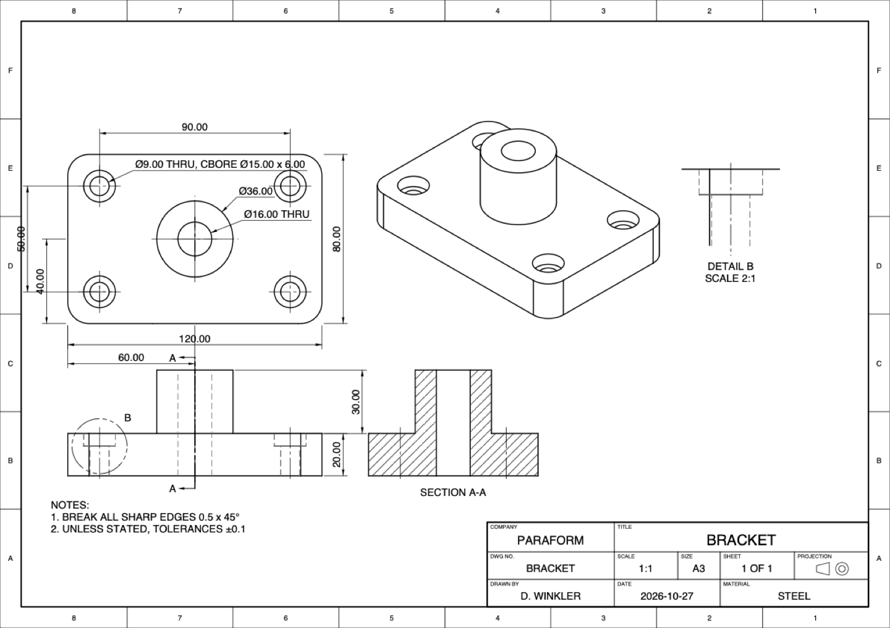
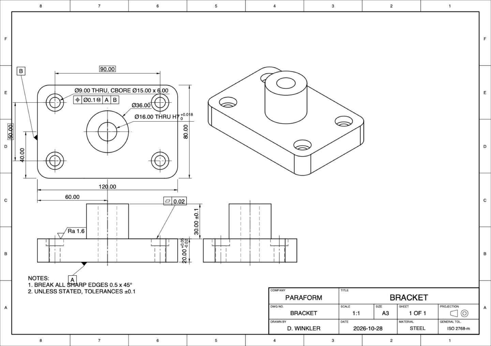

# Freo — Creo-style parametric CAD for macOS (Rust)

Freo is a native, history-based parametric 3D modeller for macOS modelled on the
PTC Creo Parametric workflow: ribbon → feature dashboard → sketcher → regenerate, with a
model tree, datum features, references, parameters and relations, assemblies built
from placement constraints, and associative 2D drawings. It is written entirely in Rust
(own geometry kernel, constraint solvers, hidden-line removal and OpenGL viewport on
egui/eframe).


| Sketching in 3D (weak + strong dims) | Extrude tab with Options panel | Edit Dimensions on the model |
|---|---|---|
|  |  |  |
| **File menu** | **Datum Plane dialog** | **Selection mini toolbar** |
|  |  |  |
| **Round sets, variable radius** | **Standard (ISO/UNC) tapped hole** | **Fill pattern in a sketched region** |
|  |  |  |

### Assemblies


| Component Placement dashboard | Exploded view | Bill of Materials + mass properties | Component opened in context |
|---|---|---|---|
|  |  |  |  |

### Drawings


| Assembly drawing: BOM table + balloons | Created dimensions (Annotate tab) | Published PDF |
|---|---|---|
|  |  |  |
| **Geometric Tolerance tab** | **Dimension tab: ISO fit H7** | **GD&T published to PDF** |
|  |  |  |

## Interface

The UI follows Creo Parametric's layout and workflow:

- Integrated title bar with the **Quick Access Toolbar** (New, Open, Save, Undo, Redo, Regenerate) and the "PRT0001 (Active)" title
- Green **File** tab with a Creo-style file menu and recently opened files; **Model / Analysis / Tools / View** ribbon tabs with Creo's groups, large/small buttons and vector icons in Creo's style
- **Contextual feature tabs** (Extrude, Revolve, Hole, Round, …) with Placement / Options / Properties slide-down panels and Preview / OK / Cancel; **dialog boxes** for Datum Plane, Axis, Point and Sketch setup
- **Sketch tab** with Creo's Setup, Operations, Datum, Sketching, Editing, Constrain, Dimension, Inspect and Close groups; sketching happens **in the 3D graphics window** on the sketch plane, with Sketch View and sketcher display filters
- **Weak dimensions**: sketches are always fully dimensioned automatically (light blue); adding a strong dimension or constraint replaces the corresponding weak one, and modifying a weak dimension makes it strong
- **Navigator** with the Model Tree (RIGHT/TOP/FRONT/PRT_CSYS_DEF, expandable Section children, failed/suppressed markers, draggable Insert Here) and a Folder Browser
- **Graphics window**: in-graphics toolbar, two-sided datum planes with tags, dash-dot axes, spin center, green selection / blue preselection, the **mini toolbar** on selection, and **double-click Edit Dimensions** with in-place value editing
- Creo-style **status bar**: message area, regeneration status indicator, placement status, selection count and selection filter
- Creo's **New** dialog (Part / Assembly, sub-types) and **Create Component** dialog

## Build & run

```bash
cargo run --release
```

Build a double-clickable `Freo.app` (with icon and `.pfprt` document type):

```bash
./scripts/bundle.sh
```

Open a model directly: `freo part.pfprt` / `freo asm0001.pfasm`, or drag a file onto
the window (a part dropped onto an open assembly is assembled).

## Features

**Modelling (Model tab)**
- Default datums FRONT / TOP / RIGHT / PRT_CSYS_DEF
- Datum plane (offset, through axis at angle), datum axis (two planes, world, normal to plane), datum point, sketch (curves)
- Extrude: add/remove, blind / symmetric / to next / to selected / through all, second side, flip, taper (draft) angle, thicken (thin wall)
- Revolve: add/remove, angle, symmetric, flip — axis is the sketch centerline
- Sweep: sketched trajectory + section (section plane normal to the trajectory start), mitered corners
- Blend: parallel blend of any number of sections with offsets
- Hole: simple / counterbore / countersink / **standard** (ISO metric coarse M2–M24 and UNC #4-40 – 1/2-13 tables: tapped with tap drill and **cosmetic thread**, or clearance close/medium/free), blind with drill tip or through all, placed on a plane or surface
- Round with **multiple sets**, each with its own radius or a **variable radius** (start → end); chamfer (D×D, D1×D2, angle×D) on straight and curved edges, convex and concave
- Shell with removed surfaces, draft about a hinge plane
- Pattern: direction (1 or 2 directions), axial, **fill** (square / diamond / triangle grid inside a sketched region, spacing, margin, rotation) and **curve** (count or spacing along a sketched curve, optionally following it); mirror selected features or all geometry
- Automatic axes (A_n) for holes, revolves, cylinders and patterned holes

**Sketcher**
- Line chains, corner/centre rectangle, centre/3-point circle, 3-point/centre arc, **ellipse**, **spline** (interpolating), palette polygon, fillet, chamfer, centerline, point, project, delete segment (**trims at intersections**), divide, corner, mirror, construction mode, Modify dialog, Feature Requirements
- Snapping to points, entities, projected model edges and sketch references, optional grid snap
- Automatic H/V constraints while drawing; constraints H, V, ⊥, ∥, =, tangent, coincident/point-on, midpoint, symmetric, fix
- Dimensions: length, horizontal/vertical/aligned distance, point–line, radius, diameter, angle; inline editing with numbers or parameter expressions
- Levenberg–Marquardt solver with live dragging, DOF readout, redundant/conflicting constraint rejection, open-end highlighting, closed-loop shading

**Model tree & editing**
- Edit Dimensions (double-click on the model), Edit Definition, rename, suppress/resume, hide/show, delete with dependent children, reorder (parent/child aware), Insert Here (rollback), failed features flagged with the reason
- Undo/redo, regenerate, object-action workflow (preselect a plane/face/edge, then pick the tool) and action-object collectors
- Parameters, relations (`H = W / 3`, functions, comments) and dimensions driven by expressions — sketch dimensions too

**Viewing & analysis**
- Spin/pan/zoom (mouse, trackpad, pinch), standard orientations, refit, perspective
- Shading with edges, shading, hidden line, no hidden, wireframe, transparency, appearance colours
- Datum display toggles, section view through any datum plane with offset
- Pre-selection highlighting, selection filters (smart, feature, surface, edge, datum), context menus
- Measure (area, length, diameter, distance, angle), mass properties (volume, area, mass, COG, inertia tensor, bounding box) with material densities, model info

**Assemblies (`.pfasm`)**
- New ▸ Assembly with ASM_RIGHT / ASM_TOP / ASM_FRONT / ASM_DEF_CSYS; **Assemble** part files (also by drag-and-drop or from the Folder Browser), **Create** a new part in the assembly, repeat instances
- **Component Placement** dashboard: Automatic, Coincident, Distance, Angle Offset, Parallel, Normal, Default and Fix constraints between planar surfaces, cylindrical surfaces (their axes), datum planes, axes, points and straight edges; offset, Flip, constraint list panel, **Allow Assumptions**, live status (No Constraints / Partially Constrained (n DOF) / Fully Constrained / Constraints invalid)
- Drag the component being placed to move it (⇧-drag rotates); the free degrees of freedom follow the mouse while the constraints hold
- Placement solver: Levenberg–Marquardt over each component's rigid transform, solved in model-tree order, with rank-based DOF status; references are stored in part coordinates and follow part edits
- Assembly model tree with placement status markers, Placement folder with the constraints and each component's features; Edit Definition, Open, Hide, Suppress, Delete (dependent constraints are removed), Assemble Another Instance
- **Open a component** to edit its features with the rest of the assembly drawn as transparent context, then **Return to Assembly**; saving writes modified parts back to their files
- **Exploded view** with adjustable distance, **Bill of Materials** (quantities, volumes, masses, CSV export), **Global Interference**, assembly **mass properties** from each part's density, per-part colours

**Drawings (`.pfdrw`)**
- New ▸ Drawing with Creo's New Drawing dialog: default model (the part or assembly in session, or browse), template with front / top / right projection views and a pictorial view scaled to fit, or empty with format; ISO A4–A0 and ANSI A–E sheets, landscape or portrait, third- or first-angle projection
- Drawing format: border with zone markers and a title block (company, title, drawing number, scale, size, sheet *n* of *m*, projection symbol, drawn by, date, material) edited in Drawing Properties
- **Layout** tab: multiple sheets, General view (saved orientations), Projection views aligned to their parent (third/first angle), Detail views (circular boundary in the parent, own scale), 2D cross-sections through a datum plane (hatched cut faces, cutting-plane line with sight arrows and letters, "SECTION A-A"), per-view scale and display style (Wireframe / Hidden / No Hidden), axes and centre marks, exploded assembly views, Lock View Movement, Open Model (edit the model in 3D, then Return to Drawing)
- Views are generated by hidden-line removal of the model (feature edges and silhouettes of curved faces, depth-tested against the facets) and follow every model change
- **Annotate** tab: Show Model Annotations places the part's sketch dimensions, depths, pattern spacings and hole callouts (e.g. "Ø9.00 THRU, CBORE Ø15.00 x 6.00", "M10x1.5") in the view where they show true length, outside the outline; modifying a shown dimension drives the model. Created (driven) dimensions snap to vertices, edges and circles (horizontal / vertical / aligned / diameter, chosen from where you place them) and re-attach after model edits; `@D` text overrides; notes; Cleanup Dimensions; decimals and text height
- **Dimension tolerances** in a contextual Dimension tab (opens when a dimension is selected): Nominal, Limits, Plus-Minus, ± Symmetric, Basic (boxed), Reference and **ISO 286 fits** (H, G, F, JS holes; h, g, f, js, k, n, p shafts; IT5–IT11 up to 500 mm) with stacked deviations, tolerance precision, and the general tolerance (e.g. ISO 2768-m) in the title block
- **GD&T**: datum feature symbols (boxed letter, filled triangle on the feature edge, next free letter skipping I/O/Q), feature control frames for all 14 characteristics (straightness … total runout) with ⌀ zone, Ⓜ/Ⓛ modifiers and up to three datum references — placed under a dimension or with a leader to an edge — and ISO 1302 surface texture symbols (any process, removal required, removal prohibited) with Ra/Rz value and production method; each has its own contextual tab, and all follow model changes
- **Table** tab: BOM table (index, part number, quantity, mass) above the title block and Create Balloons with leaders to a visible surface of each item
- Drag views (projections slide along their parent's axis), dimensions, notes, balloons and the table; double-click to edit; undo/redo
- **Publish** tab: vector **PDF** (all sheets), **DXF** (R12, layers per line type) and **SVG**

**Files**: native `.pfprt` / `.pfasm` / `.pfdrw` (JSON, full history; a drawing also embeds its model), export **STEP AP214** (faceted B-rep, one body per component), STL (binary/ASCII) and OBJ.

## Controls

| Action | Input |
|---|---|
| Spin | middle-drag, right-drag, ⌥-drag, ⌥ + two-finger scroll |
| Pan | ⇧ + middle/right-drag, ⇧ + two-finger scroll |
| Zoom | scroll wheel, pinch, ⌃ + middle-drag |
| Select / add | click / ⇧- or ⌘-click |
| Edit dimensions | double-click a surface |
| Edit definition | double-click a tree item, or the mini toolbar |
| OK / cancel feature or placement | Enter / Esc |
| Move / rotate the component being placed | drag / ⇧-drag |
| Undo / redo / regenerate | ⌘Z / ⇧⌘Z / ⌘G |

## Architecture

```
src/kernel   math, BSP-tree CSG, ear-clipping triangulation, topology (welding, T-junction
             repair, faces, edge chains), feature solid builders, planar-patch offsetting,
             hidden-line removal
src/sketch   sketch model, profile/loop extraction, constraint solver
src/model    features & references, expression evaluator, regeneration engine, thread
             tables, assemblies (placement constraints, solver, merged display, BOM),
             drawings (sheets, views, dimensions, tables, format)
src/app      controller, OpenGL renderer, camera, picking, sketcher UI, dashboards,
             ribbon/tree/status, dialogs, export & mass properties, demo scenes
```

References to faces and edges are stored geometrically and re-resolved on every
regeneration, so downstream features follow upstream dimension changes.

## Testing

```bash
cargo test                                   # unit + end-to-end workflow tests
cargo run --release --bin kernel_demo -- out # regenerate sample parts and render PNGs
FREO_DEMO=bracket FREO_SHOT=shot.png FREO_EXIT=1 cargo run --release   # app screenshot
```

## Scope compared with Creo

Freo reimplements the core part-modelling, assembly and drawing workflow. It does not
include Creo's sheet metal, surfacing, simulation, mechanisms, 3D annotations (MBD) or STEP/IGES import, and
its kernel is polyhedral (curved surfaces are faceted, so STEP export is a faceted B-rep and
drawing views of curved surfaces show their facets' silhouettes) rather than an exact NURBS
B-rep.
"Creo" is a trademark of PTC Inc.; Freo is an independent project and is not affiliated with PTC.
